# Backend Architecture

The backend is a Node.js + Express 5 REST API that handles all business logic, data persistence, and integration with external services.

## Directory Structure

```text
backend/
├── prisma/
│   ├── schema.prisma          # Database schema definition
│   ├── seed.js                # Seed script for initial data
│   └── migrations/            # Database migration files
├── scripts/
│   ├── preflight.js           # Environment validation script
│   └── update-no-reply-templates.js
├── src/
│   ├── server.js              # Application entry point
│   ├── controllers/           # Request handlers
│   │   ├── authController.js
│   │   ├── ticketController.js
│   │   ├── userController.js
│   │   ├── departmentController.js
│   │   ├── settingsController.js
│   │   ├── knowledgeBaseController.js
│   │   ├── statusIssueController.js
│   │   ├── operationsController.js
│   │   ├── formController.js
│   │   └── viewController.js
│   ├── routes/                # API route definitions
│   │   ├── auth.js
│   │   ├── tickets.js
│   │   ├── users.js
│   │   ├── departments.js
│   │   ├── settings.js
│   │   ├── knowledgeBase.js
│   │   ├── statusIssues.js
│   │   ├── operations.js
│   │   ├── notifications.js
│   │   ├── forms.js
│   │   ├── views.js
│   │   └── publicTickets.js
│   ├── services/              # Business logic and integrations
│   │   ├── emailService.js
│   │   ├── adService.js
│   │   └── scheduler.js
│   └── middleware/             # Express middleware
│       ├── auth.js
│       └── security.js
├── package.json
└── .env
```

## Request Lifecycle

```mermaid
flowchart LR
    A["Incoming Request"] --> B["Request ID Middleware"]
    B --> C["Security Headers"]
    C --> D["CORS Check"]
    D --> E["Rate Limiter"]
    E --> F["JSON Body Parser"]
    F --> G["Auth Middleware"]
    G --> H["Route Handler"]
    H --> I["Controller"]
    I --> J["Service / Prisma"]
    J --> K["Response"]
```



## Server Entry Point

The application starts in `backend/src/server.js`.

Key initialization steps:
1. Load environment variables via `dotenv/config`
2. Create Express application
3. Apply security middleware (request ID, headers, CORS, rate limiting)
4. Mount all API route modules
5. Register error handling middleware
6. Start email monitoring if configured
7. Begin listening on the configured port

## Route Mounting Order

Routes are mounted in a specific order to ensure correct matching:

1. `/api/auth` — Authentication (with strict rate limiting)
2. `/api/departments` — Department management
3. `/api/users` — User management
4. `/api/notifications` — Notifications
5. `/api/settings` — System settings
6. `/api/views` — Saved views
7. `/api/knowledge-base` — Knowledge base articles
8. `/api/status-issues` — Status issues
9. `/api/forms` — Custom forms
10. `/api/operations` — Dashboard analytics and SLA
11. `/api/public/tickets` — Public ticket intake (with rate limiting)
12. `/api/tickets/public` — Alias for Google Add-on compatibility
13. `/api/tickets` — Staff ticket management (must come after public routes)
