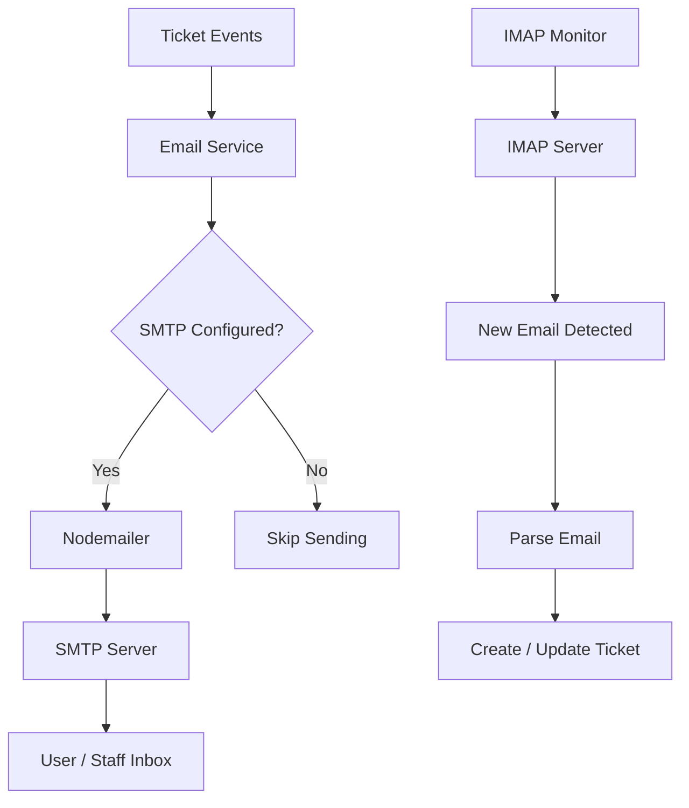

# Email Service Architecture

The email service handles all outbound and inbound email communication for the ticketing system.

## Components



## Outbound Email (SMTP)

### Triggering Events

| Event | Email Type | Template Key |
|-------|-----------|--------------|
| Ticket created | Confirmation | `ticketCreated` |
| Ticket status changed | Update | `ticketUpdated` |
| Ticket resolved | Resolution | `ticketResolved` |
| Ticket assigned | Assignment | `ticketAssigned` |
| New comment added | Notification | `commentAdded` |
| Overdue SLA alert | Alert | `slaBreached` |

### Email Templates

Email templates are stored in the `EmailTemplate` model and managed through the admin panel.

Default templates include:
- **Ticket Created:** Confirms receipt and provides ticket number.
- **Ticket Updated:** Notifies requester of status or priority changes.
- **Ticket Resolved:** Announces resolution and requests feedback.

### Configuration

SMTP settings are stored in `SystemSettings` and can be updated via `/api/settings`:

```env
EMAIL_SERVICE=gmail
EMAIL_USER=itsupport@kuccps.ac.ke
EMAIL_PASSWORD=app-password
EMAIL_FROM="KUCCPS IT Support <itsupport@kuccps.ac.ke>"
SUPPORT_EMAIL=itsupport@kuccps.ac.ke
```

## Inbound Email Monitoring (IMAP)

### How It Works

1. The backend polls the IMAP mailbox at the configured interval.
2. New emails are parsed to extract subject, body, and attachments.
3. Emails are matched to existing tickets using the subject line or references.
4. Ticket content is updated, or new comments are added.
5. Notifications are sent to assigned staff.

### Configuration

```env
IMAP_HOST=imap.gmail.com
IMAP_PORT=993
IMAP_USER=itsupport@kuccps.ac.ke
IMAP_PASSWORD=app-password
IMAP_TLS=true
IMAP_POLL_INTERVAL=5
```

### Enabling/Disabling

Email monitoring starts automatically on server boot if both `EMAIL_USER` and `IMAP_USER` are configured. It can be toggled via the admin panel.

## Email Configuration Model

The `EmailConfig` model tracks configured mailboxes:

| Field | Purpose |
|-------|---------|
| `provider` | Email provider name (e.g., `gmail`) |
| `email` | Unique mailbox address |
| `isActive` | Whether this config is active |
| `lastChecked` | Last time the mailbox was polled |

## Security Considerations

1. **TLS Enforcement:** Use `IMAP_TLS_REJECT_UNAUTHORIZED=true` in production.
2. **App Passwords:** For Gmail, use app passwords instead of account passwords.
3. **Firewall Rules:** Ensure the server can reach SMTP (port 587/465) and IMAP (port 993) hosts.
4. **Rate Limits:** The backend applies rate limiting to public endpoints to prevent abuse.
