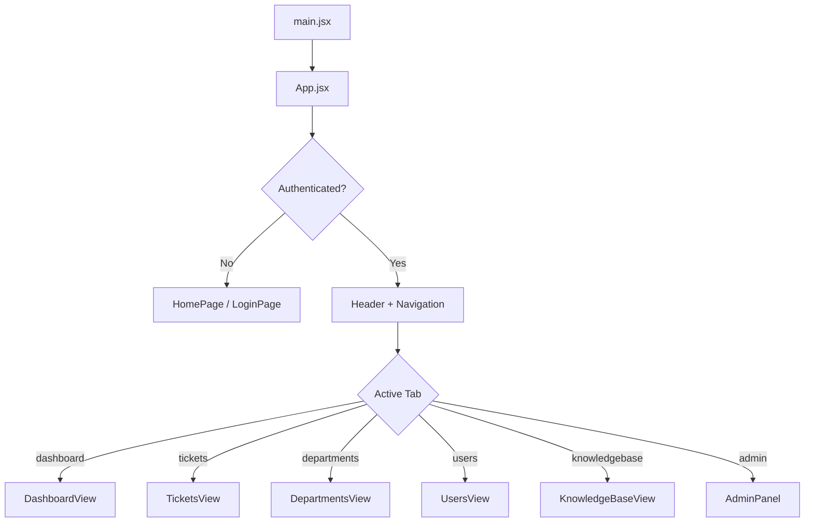
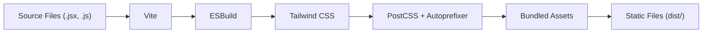

# Frontend Architecture

The frontend is a React 19 single-page application built with Vite and Tailwind CSS. It provides the user interface for all authenticated operations.

## Directory Structure

```text
frontend/
├── src/
│   ├── main.jsx               # Application entry point
│   ├── App.jsx                # Root component with routing
│   ├── index.css              # Global styles
│   ├── App.css                # App-level styles
│   ├── assets/                # Static assets
│   ├── components/
│   │   ├── auth/              # Login and home pages
│   │   │   ├── HomePage.jsx
│   │   │   └── LoginPage.jsx
│   │   ├── layout/            # Shared layout components
│   │   │   ├── Header.jsx
│   │   │   ├── Navigation.jsx
│   │   │   ├── StatCard.jsx
│   │   │   └── NotificationBell.jsx
│   │   ├── dashboard/         # Dashboard view and charts
│   │   │   ├── DashboardView.jsx
│   │   │   ├── QuickStatsCards.jsx
│   │   │   ├── TopCategoriesChart.jsx
│   │   │   └── charts/        # Individual chart components
│   │   ├── tickets/           # Ticket management
│   │   │   ├── TicketsView.jsx
│   │   │   ├── TicketCard.jsx
│   │   │   ├── TicketRow.jsx
│   │   │   ├── TicketDetailModal.jsx
│   │   │   ├── TicketAssignModal.jsx
│   │   │   ├── TicketFilters.jsx
│   │   │   ├── QuickFilters.jsx
│   │   │   ├── SavedFilters.jsx
│   │   │   └── AdvancedSearchModal.jsx
│   │   ├── departments/       # Department management
│   │   │   ├── DepartmentsView.jsx
│   │   │   ├── DepartmentCard.jsx
│   │   │   ├── DepartmentModal.jsx
│   │   │   ├── DepartmentDetailModal.jsx
│   │   │   └── UserTicketsDrawer.jsx
│   │   ├── users/             # User management
│   │   │   ├── UsersView.jsx
│   │   │   ├── UserCard.jsx
│   │   │   └── UserModal.jsx
│   │   ├── knowledgebase/     # Knowledge base
│   │   │   └── KnowledgeBaseView.jsx
│   │   ├── admin/             # Admin panel
│   │   │   ├── AdminPanel.jsx
│   │   │   ├── OrganizationSettings.jsx
│   │   │   ├── EmailSettings.jsx
│   │   │   ├── EmailTemplates.jsx
│   │   │   ├── ActiveDirectorySettings.jsx
│   │   │   ├── TicketSettings.jsx
│   │   │   └── CustomFormsSettings.jsx
│   │   ├── settings/          # User settings
│   │   │   └── NotificationPreferences.jsx
│   │   ├── status/            # Status pages
│   │   │   └── StatusPageView.jsx
│   │   └── common/            # Reusable components
│   │       ├── Logo.jsx
│   │       ├── LoadingSpinner.jsx
│   │       ├── ErrorMessage.jsx
│   │       └── SuccessMessage.jsx
│   ├── services/              # API client modules
│   │   ├── api.js
│   │   ├── authService.js
│   │   ├── ticketService.js
│   │   ├── userService.js
│   │   ├── departmentService.js
│   │   ├── settingsService.js
│   │   ├── knowledgeBaseService.js
│   │   ├── operationsService.js
│   │   ├── statusIssueService.js
│   │   ├── formService.js
│   │   ├── viewService.js
│   │   └── notificationService.js
│   ├── hooks/                 # Custom React hooks
│   │   ├── useAuth.js
│   │   ├── useTickets.js
│   │   ├── useUsers.js
│   │   ├── useDepartments.js
│   │   └── useStatistics.js
│   ├── utils/                 # Utility functions
│   │   ├── constants.js
│   │   ├── exportUtils.js
│   │   └── analytics.js
│   └── styles/
│       └── animations.css
├── public/
│   └── vite.svg
├── package.json
├── vite.config.js
├── tailwind.config.js
├── postcss.config.js
└── index.html
```

## Application Flow



## Component Communication

Components communicate through a unidirectional data flow:

1. **App.jsx** holds the global state (authentication, active tab, user data).
2. **Services** handle all API communication and return promises.
3. **Hooks** wrap service calls and provide loading/error states.
4. **Components** consume hooks and render UI based on state.

## State Management

The application uses React's built-in state management:

- **Local State:** `useState` for component-level state (modals, filters, forms).
- **Derived State:** `useMemo` and `useCallback` for expensive computations.
- **Persistence:** `localStorage` for JWT token and user session.
- **Server State:** Custom hooks (`useTickets`, `useUsers`, etc.) fetch and cache data.

## Styling

The application uses **Tailwind CSS** with a custom design system:

- **Brand Colors:** Configurable via system settings (`primaryColor`, `secondaryColor`).
- **Dark Mode:** Toggled via `theme-dark` class on `<body>`.
- **High Contrast:** Toggled via `theme-high-contrast` class.
- **Animations:** Custom CSS animations in `animations.css`.
- **Responsive:** Mobile-first design with Tailwind responsive utilities.

## Build Pipeline



## Environment Variables

| Variable | Purpose | Required |
|----------|---------|----------|
| `VITE_API_URL` | Backend API base URL | Yes |

Vite exposes only variables prefixed with `VITE_` to the browser.
