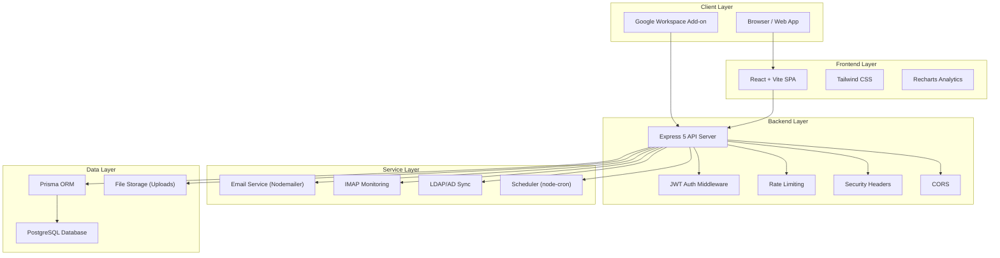
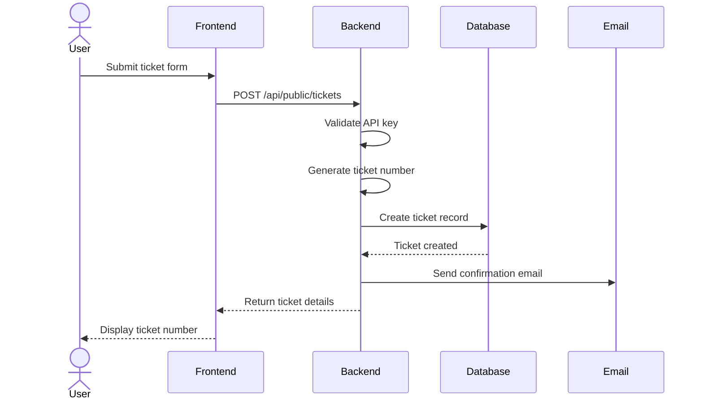
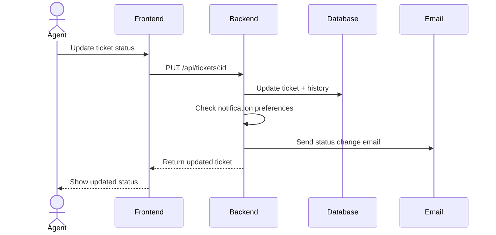

# Architecture Overview

This document provides a high-level overview of the KUCCPS IT Ticketing System architecture.

## System Diagram

## Architecture Layers

### 1. Client Layer

The system serves two types of clients:

- **Browser / Web App:** A React single-page application that provides the full admin and staff interface.
- **Google Workspace Add-on:** A Gmail contextual add-on that allows users to create tickets directly from Gmail.

### 2. Frontend Layer

The frontend is a modern React application built with Vite.

| Component | Technology | Purpose |
|-----------|------------|---------|
| UI Framework | React 19 | Component-based UI |
| Build Tool | Vite | Fast development and building |
| Styling | Tailwind CSS | Utility-first CSS |
| Icons | Lucide React | Icon library |
| Charts | Recharts | Analytics visualization |
| Notifications | React Hot Toast | Toast notifications |
| Routing | React Router DOM | Client-side routing |

### 3. Backend Layer

The backend is an Express 5 REST API server.

| Component | Technology | Purpose |
|-----------|------------|---------|
| Framework | Express 5 | HTTP server and routing |
| ORM | Prisma | Database access and migrations |
| Database | PostgreSQL | Data persistence |
| Auth | JWT + bcrypt | Authentication and password hashing |
| Email | Nodemailer | Outbound email |
| Monitoring | IMAP | Inbound email monitoring |
| Scheduling | node-cron | Background jobs |
| File Upload | Multer | Attachment handling |
| LDAP | ldapauth-fork + ldapjs | Active Directory integration |

### 4. Service Layer

Background services that operate independently of HTTP requests:

- **Email Service:** Sends ticket lifecycle notifications via SMTP.
- **IMAP Monitoring:** Polls the support mailbox for incoming emails and processes them as ticket replies.
- **LDAP/AD Sync:** Syncs users and directorates from Active Directory.
- **Scheduler:** Runs cron jobs for SLA checks, daily digests, and other periodic tasks.

### 5. Data Layer

- **PostgreSQL:** Primary data store for all application data.
- **Prisma ORM:** Type-safe database access with migration management.
- **File Storage:** Local filesystem for ticket attachments and knowledge base materials.

## Data Flow: Ticket Creation

## Data Flow: Ticket Update and Notification

## Key Design Decisions

1. **Separate Frontend and Backend:** Decoupled architecture allows independent scaling and deployment.
2. **Prisma ORM:** Provides type safety, migration management, and database portability.
3. **JWT Authentication:** Stateless authentication suitable for REST APIs.
4. **Public Ticket API:** Allows external intake (Google Add-on) without exposing admin endpoints.
5. **CORS Whitelisting:** Restricts API access to configured frontend origins.
6. **Rate Limiting:** Protects sensitive endpoints from abuse.
7. **Atomic Ticket Numbers:** Uses a mutex to prevent duplicate ticket numbers under concurrent load.
