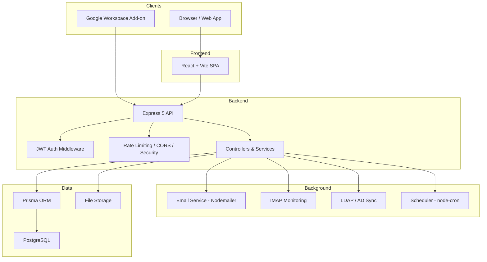
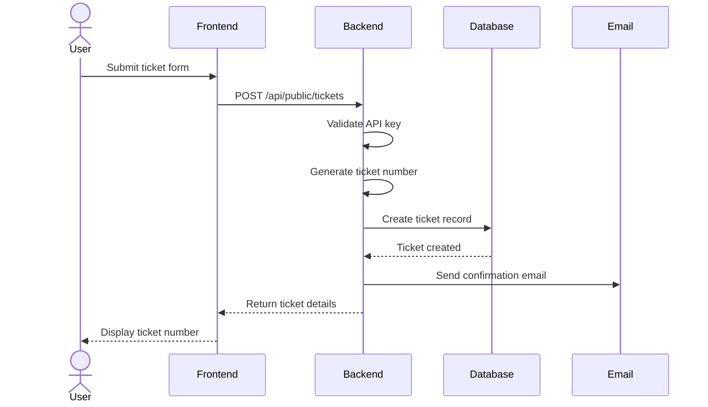
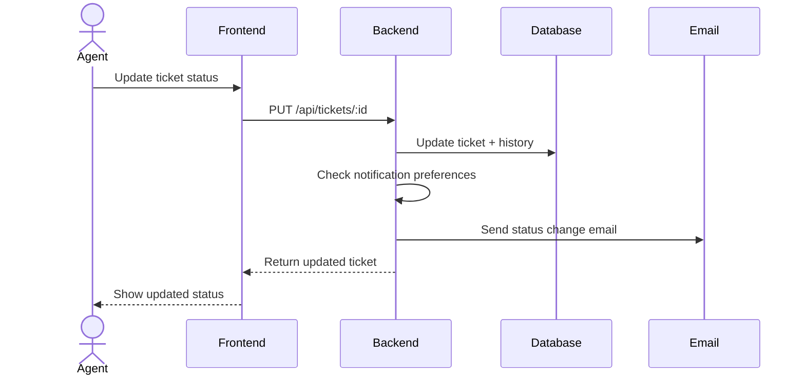
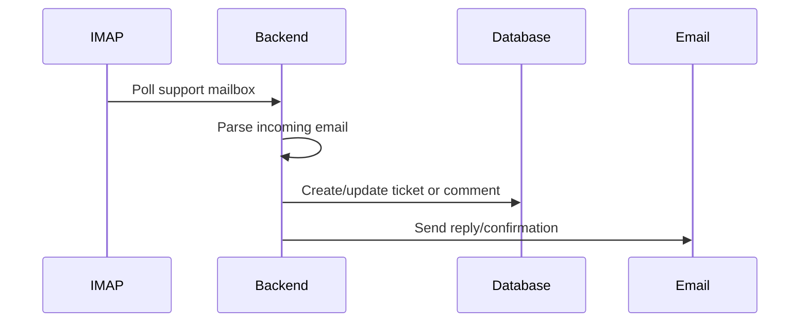
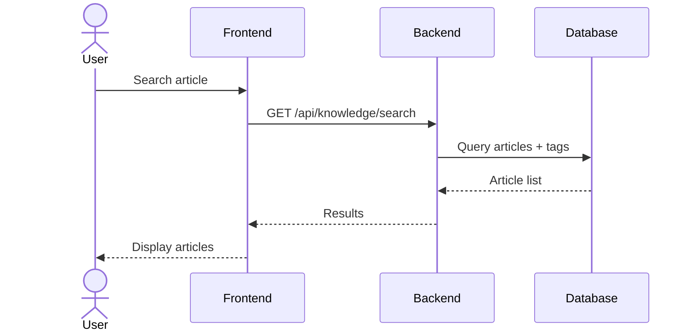

# Schema Diagram and Data Flow

## Database Schema Diagram (Normalized)

```mermaid
erDiagram
    Department ||--o{ User : contains
    Department ||--o{ Ticket : receives
    Department ||--o{ SlaPolicy : has

    User ||--o{ Ticket : "creates"
    User ||--o{ Ticket : "assigned_to"
    User ||--o{ Comment : writes
    User ||--o{ SavedView : owns
    User ||--o{ CsatResponse : submits
    User ||--|| NotificationPreference : has
    User }|--|| Department : "belongs_to"
    User }o--o{ AccessRole : "has role"
    AccessRole }o--o{ AccessPermission : grants
    UserRole ||--|| User : belongs_to
    UserRole ||--|| AccessRole : belongs_to
    RolePermission ||--|| AccessRole : belongs_to
    RolePermission ||--|| AccessPermission : grants

    Ticket ||--o{ Attachment : has
    Ticket ||--o{ Comment : has
    Ticket ||--o{ TicketHistory : tracks
    Ticket ||--o{ CsatResponse : receives
    Ticket ||--o{ Notification : triggers

    StatusIssue ||--o{ StatusIssueUpdate : has
    StatusIssue }o--o{ StatusSystem : affects
    StatusIssueSystem ||--|| StatusIssue : belongs_to
    StatusIssueSystem ||--|| StatusSystem : references

    CustomForm ||--o{ CustomFormField : contains
    SlaPolicy }|--|| Department : "applies_to"
    SlaPolicy ||--o{ SlaPolicyAudit : audits
    SlaPolicyAudit }|--|| SlaPolicy : references

    Notification ||--|| User : targets
    Notification ||--o{ Ticket : references

    KnowledgeArticle ||--o{ KnowledgeRevision : has
    KnowledgeArticle ||--o{ KnowledgeFeedback : receives
    KnowledgeArticle }o--o{ KnowledgeTag : tagged_with
    KnowledgeArticleTag ||--|| KnowledgeArticle : belongs_to
    KnowledgeArticleTag ||--|| KnowledgeTag : references
    KnowledgeArticle }o--o{ KnowledgeArticle : related_to
    KnowledgeArticleRelation ||--|| KnowledgeArticle : from
    KnowledgeArticleRelation ||--|| KnowledgeArticle : to
    KnowledgeArticleRelatedReference ||--|| KnowledgeArticle : belongs_to

    SystemSettings ||--o{ SystemSettingsAllowedFileType : allows
    SystemSettingsAllowedFileType ||--|| SystemSettings : belongs_to
```

## Data Flow Diagram



## Key Data Flows

### Ticket Creation


### Ticket Update and Notification


### Email Processing


### Knowledge Base Operations

