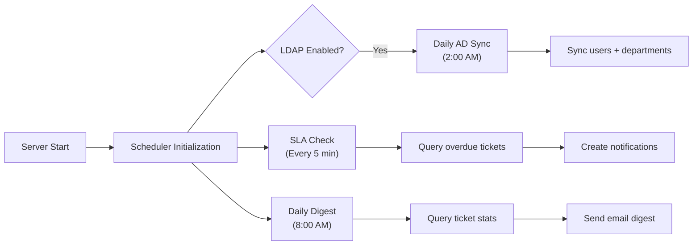

# Scheduler

The scheduler runs periodic background jobs using `node-cron`.

## Architecture

## Jobs

### SLA Check

**Schedule:** Every 5 minutes

**Function:** Queries tickets where `slaDueAt < now()` and `slaBreached = false`. Marks them as breached and creates notifications for assigned staff.

**Impact:** Ensures SLA compliance is monitored in real-time.

### Daily Digest

**Schedule:** 8:00 AM EAT daily

**Function:** Generates a summary of ticket activity for the previous day and emails it to staff members.

**Impact:** Keeps staff informed without requiring them to check the dashboard.

### Active Directory Sync

**Schedule:** 2:00 AM EAT daily

**Function:** Syncs users and directorates from AD when `ldapEnabled` is true.

**Impact:** Keeps local user directory in sync with organizational changes.

## Job Management

Jobs are initialized when the server starts. If a job fails, the error is logged but does not prevent other jobs from running.

## Manual Triggers

Some operations can be triggered manually via API endpoints:

- **Test Email:** `POST /api/notifications/test` — Sends a test notification email.
- **AD Sync:** `POST /api/users/sync/ad` and `POST /api/departments/sync/ad` — Manual sync triggers.
