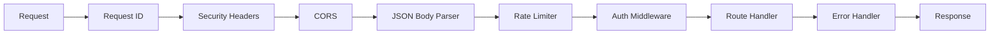

# Server Setup

The Express server is the core of the backend. This document covers initialization, middleware, and request handling.

## Entry Point

**File:** `backend/src/server.js`

The server initializes in the following order:

1. Load environment variables (`dotenv/config`)
2. Create Express application
3. Validate production configuration
4. Apply security middleware
5. Mount API routes
6. Register error handler
7. Start email monitoring (if configured)
8. Begin listening on the configured port

## Middleware Stack



### Middleware Details

| Middleware | Source | Purpose |
|------------|--------|---------|
| `requestId` | `middleware/security.js` | Assigns a unique ID to each request for tracing |
| `securityHeaders` | `middleware/security.js` | Sets `X-Content-Type-Options`, `X-Frame-Options`, `Referrer-Policy`, `Permissions-Policy`, `Cross-Origin-Resource-Policy` |
| `cors` | `cors` package | Restricts origins to configured whitelist |
| `express.json()` | Express | Parses JSON request bodies (limit: 1mb by default) |
| `rateLimit` | `express-rate-limit` | Limits requests per IP per time window |
| `requireStaffOrAdmin` | `middleware/auth.js` | Protects staff/admin routes |
| `requireAdmin` | `middleware/auth.js` | Protects admin-only routes |

## Rate Limiting

Rate limits are applied at different levels:

| Scope | Window | Max Requests | Purpose |
|-------|--------|-------------|---------|
| Global | 15 minutes | 600 | General API protection |
| Auth routes | 15 minutes | 30 | Brute-force protection |
| Public tickets | 15 minutes | 30 | Spam prevention |

## Health Check

```http
GET /health
```

Response:

```json
{
  "status": "OK",
  "message": "KUCCPS Ticketing System API is running"
}
```

The health check dynamically fetches the organization name from `SystemSettings`.

## Error Handling

All unhandled errors are caught by the error-handling middleware:

| Error Type | Status | Response |
|------------|--------|----------|
| CORS origin denied | 403 | `{ "success": false, "message": "CORS origin denied" }` |
| File too large | 413 | `{ "success": false, "message": "Uploaded file is too large" }` |
| Invalid file type | 415 | `{ "success": false, "message": "File type is not allowed" }` |
| Server error | 500 | `{ "success": false, "message": "Server error" }` |

## Graceful Shutdown

The server can be stopped gracefully to allow in-flight requests to complete. Currently, the server relies on process signals for shutdown.

## Production Validation

`validateProductionConfig()` runs on startup and enforces:

- `NODE_ENV=production` requires explicit CORS origins (no wildcard).
- `REQUIRE_PUBLIC_TICKET_API_KEY=true` requires a valid `PUBLIC_TICKET_API_KEY`.
- `JWT_SECRET` length validation.
- TLS enforcement for LDAP, SMTP, and IMAP when corresponding flags are set.
