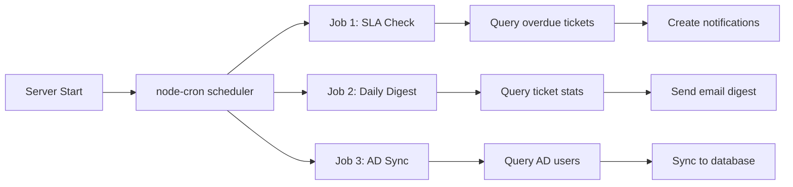

# Services

Services contain the business logic and integration code that controllers call.

## Email Service

**File:** `backend/src/services/emailService.js`

### Responsibilities

- Sending ticket lifecycle emails via SMTP
- Starting and managing IMAP monitoring
- Processing incoming emails and creating ticket replies

### Key Functions

| Function | Purpose |
|----------|---------|
| `sendTicketCreatedEmail(ticket)` | Send confirmation when ticket is created |
| `sendTicketUpdatedEmail(ticket, changes)` | Notify requester of status/priority changes |
| `sendTicketResolvedEmail(ticket)` | Announce resolution and request CSAT |
| `startEmailMonitoring()` | Begin IMAP polling loop |
| `processIncomingEmail(email)` | Parse and route incoming email to ticket |

### Email Template Resolution

Templates are loaded from the `EmailTemplate` model in the database. If a template is missing, the service falls back to a hardcoded default.

## Active Directory Service

**File:** `backend/src/services/adService.js`

### Responsibilities

- Authenticating users against LDAP/Active Directory
- Syncing users from AD to the local database
- Syncing directorates (organizational units/groups) as departments

### Key Functions

| Function | Purpose |
|----------|---------|
| `authenticateLDAP(username, password)` | Validate credentials against AD |
| `syncUsers()` | Import users from AD |
| `syncDirectorates()` | Import directorates as departments |

### LDAP Configuration

LDAP settings are stored in `SystemSettings` and include:

- `ldapUrl` — LDAPS server URL
- `ldapBindDn` — Service account DN
- `ldapBindPassword` — Service account password
- `ldapUserSearchBase` — Base DN for user searches
- `ldapUserFilter` — LDAP filter for user objects
- `ldapUsernameAttribute` — Attribute mapped to username
- `ldapEmailAttribute` — Attribute mapped to email
- `ldapNameAttribute` — Attribute mapped to display name

## Scheduler

**File:** `backend/src/services/scheduler.js`

### Responsibilities

- Running periodic background jobs using `node-cron`

### Scheduled Jobs

| Job | Schedule | Purpose |
|-----|----------|---------|
| SLA Check | Every 5 minutes | Identify overdue tickets and create notifications |
| Daily Digest | Daily at 8:00 AM | Send daily ticket summary to staff |
| AD Sync | Daily at 2:00 AM | Sync users and directorates from AD (if enabled) |

### Job Lifecycle

