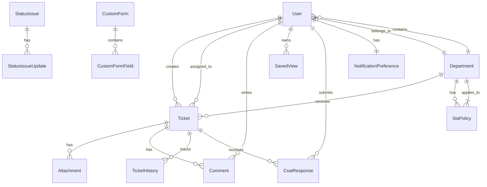

# Database Schema

The database schema is defined in `backend/prisma/schema.prisma` and consists of 15 models.

## Model Summary

| Model | Purpose | Key Fields |
|-------|---------|------------|
| `User` | Application users | email, username, role, departmentId |
| `Department` | Organizational units | name, code |
| `Ticket` | Support tickets | ticketNumber, status, priority, category |
| `Attachment` | Ticket files | filename, filepath, mimetype, size |
| `Comment` | Ticket comments | content, isInternal |
| `TicketHistory` | Audit trail | field, oldValue, newValue |
| `SystemSettings` | Global configuration | organizationName, smtp settings, ldap settings |
| `EmailTemplate` | Email templates | type, subject, html |
| `SavedView` | Saved ticket filters | name, filters, visibility |
| `KnowledgeArticle` | KB articles | title, slug, content, status |
| `StatusIssue` | Status incidents | title, status, severity |
| `StatusIssueUpdate` | Status updates | message, status |
| `CustomForm` | Intake forms | name, isActive |
| `CustomFormField` | Form fields | label, key, type, required |
| `SlaPolicy` | SLA policies | responseMinutes, resolutionMinutes |
| `CsatResponse` | CSAT ratings | rating, comment |
| `NotificationPreference` | User notification settings | emailOnAssignment, dailyDigest |
| `EmailConfig` | Mailbox configuration | provider, email, isActive |

## Key Relationships



## Indexing Strategy

The schema defines indexes on frequently queried fields:

```prisma
@@index([email])
@@index([username])
@@index([ticketNumber])
@@index([status])
@@index([priority])
@@index([requesterEmail])
@@index([createdAt])
```

These indexes improve query performance for common filters like ticket search and user lookup.

## Enums and Constraints

- **Role:** `user`, `staff`, `admin` (stored as `String` with validation)
- **Status:** `Open`, `In Progress`, `Resolved`, `Closed`
- **Priority:** `Low`, `Medium`, `High`, `Critical`
- **Severity:** `Informational`, `Warning`, `Error`
- **Visibility:** `private`, `shared`, `global`

## Cascading Deletes

```prisma
Attachment {
  ticket Ticket @relation(fields: [ticketId], references: [id], onDelete: Cascade)
}
```

When a ticket is deleted, its attachments, comments, history, and CSAT responses are automatically deleted.
