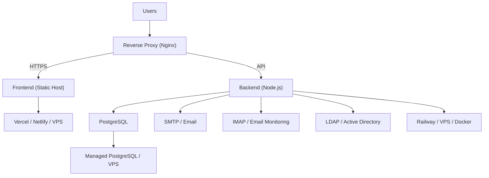

# Deployment Overview

This section covers deploying the KUCCPS IT Ticketing System to production.

## Architecture

## Deployment Options

| Component | Recommended | Alternatives |
|-----------|-------------|--------------|
| Frontend | Vercel, Netlify, or static VPS | Cloudflare Pages, AWS S3 + CloudFront |
| Backend | Railway, Render, or VPS | AWS EC2, Google Cloud Run, Docker |
| Database | Supabase, Neon, or managed PostgreSQL | AWS RDS, Google Cloud SQL |
| Reverse Proxy | Nginx on same VPS as backend | Caddy, Cloudflare Tunnel |

## Pre-Deployment Checklist

See [Production Checklist](./production-checklist) for the full list.

Key items:
1. Rotate `JWT_SECRET` and `PUBLIC_TICKET_API_KEY`
2. Set `NODE_ENV=production`
3. Configure explicit CORS origins (HTTPS)
4. Set `REQUIRE_PUBLIC_TICKET_API_KEY=true`
5. Configure SMTP and test email delivery
6. Enable LDAPS for AD integration
7. Backup existing data
8. Test all features in staging
