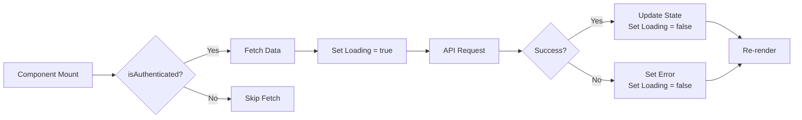

# Hooks

Custom React hooks encapsulate data fetching and state management logic.

## useAuth

**File:** `frontend/src/hooks/useAuth.js`

Manages authentication state:

- Reads JWT token from `localStorage`
- Provides `isAuthenticated` boolean
- Provides `currentUser` object
- Handles logout cleanup

```javascript
const { isAuthenticated, currentUser, logout } = useAuth();
```

## useTickets

**File:** `frontend/src/hooks/useTickets.js`

Manages ticket data fetching:

```javascript
const { tickets, isLoading, error, fetchTickets } = useTickets(isAuthenticated);
```

- Fetches tickets when `isAuthenticated` becomes true
- Provides loading and error states
- Exposes `fetchTickets` for manual refresh

## useUsers

**File:** `frontend/src/hooks/useUsers.js`

Manages user data fetching:

```javascript
const { users, isLoading, error, fetchUsers } = useUsers(isAuthenticated);
```

## useDepartments

**File:** `frontend/src/hooks/useDepartments.js`

Manages department data fetching:

```javascript
const { departments, isLoading, error, fetchDepartments } = useDepartments(isAuthenticated);
```

## useStatistics

**File:** `frontend/src/hooks/useStatistics.js`

Manages dashboard statistics fetching:

```javascript
const { statistics, isLoading, error, fetchStatistics } = useStatistics(isAuthenticated);
```

## Hook Lifecycle



## Dependency Management

Hooks use `useEffect` with `isAuthenticated` as a dependency to trigger data fetching when authentication state changes.
