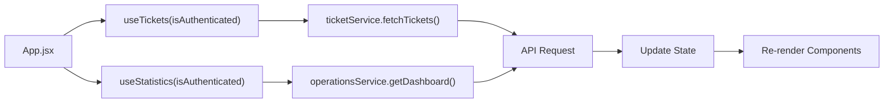
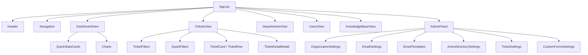

# Frontend Overview

The frontend is a React 19 single-page application that serves as the primary interface for ICT staff and administrators.

## Technology Stack

| Technology | Version | Purpose |
|------------|---------|---------|
| React | 19.2 | UI framework |
| Vite | 7.2 | Build tool and dev server |
| Tailwind CSS | 3.4 | Utility-first CSS |
| Lucide React | 0.554 | Icon library |
| Recharts | 3.4 | Data visualization |
| React Router DOM | Latest | Client-side routing |
| React Hot Toast | Latest | Toast notifications |

## Entry Points

### main.jsx

```jsx
import React from 'react';
import ReactDOM from 'react-dom/client';
import App from './App.jsx';
import './index.css';

ReactDOM.createRoot(document.getElementById('root')).render(
  <React.StrictMode>
    <App />
  </React.StrictMode>
);
```

### App.jsx

The root component manages:
- Authentication state
- Active tab/navigation
- Global data fetching (tickets, statistics)
- Branding application from public settings

## Tab-Based Navigation

The authenticated interface uses a tab-based layout:

| Tab | Component | Role Access |
|-----|-----------|-------------|
| Dashboard | `DashboardView` | Staff, Admin |
| Tickets | `TicketsView` | Staff, Admin |
| Departments | `DepartmentsView` | Staff, Admin |
| Users | `UsersView` | Staff, Admin |
| Knowledge Base | `KnowledgeBaseView` | Staff, Admin |
| Admin | `AdminPanel` | Admin only |

## Data Fetching Strategy

The application uses a custom hook-based data fetching pattern:



## Component Hierarchy



## State Management

The application uses React's built-in state management without external libraries:

- **Local State:** `useState` for UI state (modals, filters, forms)
- **Derived State:** `useMemo` for expensive calculations (filtered ticket lists)
- **Side Effects:** `useEffect` for data fetching and branding application
- **Persistence:** `localStorage` for JWT token and user session
