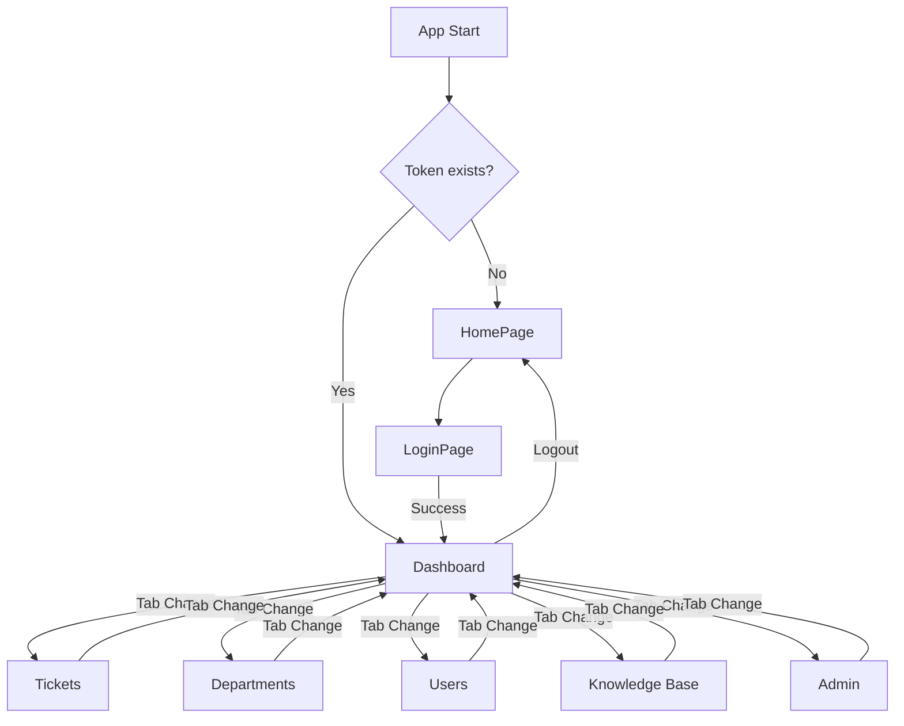

# Routing

The frontend uses React Router DOM for client-side navigation.

## Router Configuration

**File:** `frontend/src/App.jsx`

The application does not use a `<BrowserRouter>` with explicit routes. Instead, it uses a **tab-based architecture** where the active view is determined by the `activeTab` state variable.

```javascript
const [activeTab, setActiveTab] = useState('dashboard');

// Render based on active tab
{activeTab === 'dashboard' && <DashboardView ... />}
{activeTab === 'tickets' && <TicketsView ... />}
{activeTab === 'departments' && <DepartmentsView />}
{activeTab === 'users' && <UsersView />}
{activeTab === 'knowledgebase' && <KnowledgeBaseView />}
{activeTab === 'admin' && <AdminPanel />}
```

## Navigation Flow



## Modal-Based Navigation

Many features use modals instead of route changes:

- **TicketDetailModal:** Opens from TicketsView to show ticket details
- **TicketAssignModal:** Opens from TicketDetailModal for assignment
- **DepartmentModal:** Opens from DepartmentsView for create/edit
- **UserModal:** Opens from UsersView for create/edit
- **AdvancedSearchModal:** Opens from TicketsView for search

## Public Routes

| Path | Component | Access |
|------|-----------|--------|
| `/` | `HomePage` | Public |
| `/login` | `LoginPage` | Public |
| `/knowledge-base` | `KnowledgeBaseView` | Public (limited) |

## Protected Routes

All other views require authentication. The `App.jsx` component checks for a valid token before rendering the authenticated layout.

## Deep Linking

Currently, the application does not support deep linking to specific tabs via URL. The active tab is managed entirely through component state. Future enhancement could involve URL-based routing for shareable links.
